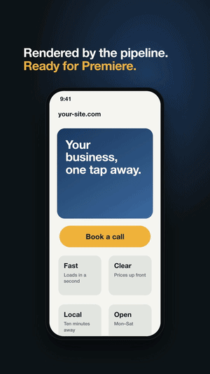
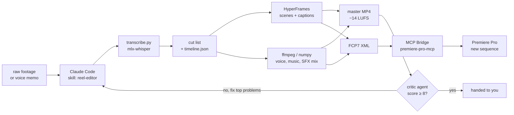

<div align="center">

# Claude × Premiere Pro

**Claude Code edits your Reels, TikToks and Shorts in Adobe Premiere Pro, and a critic agent scores every cut until it reaches 8/10.**

[](LICENSE)
[](#quick-start)
[](https://github.com/hetpatel-11/Adobe_Premiere_Pro_MCP)
[](#what-it-produces)



<sub>The bundled demo reel, rendered end to end by the pipeline from a synthetic voice: <code>zsh examples/demo/make_demo.sh</code></sub>

</div>

You give Claude raw footage or a voice memo. It transcribes, finds the cuts, builds motion graphics and captions, mixes the sound, writes a **new sequence into your Premiere project**, exports a master, and then hands the result to a **ruthless critic agent**. Below 8/10 it fixes what the critic found and asks again. You only see the video once it passes.

This repo is the editing brain: the Claude Code plugin **`premiere-reel-editor`** with two skills, one critic agent, scene templates and the Python/ffmpeg pipeline they drive. Premiere is controlled through the open-source [MCP Bridge for Adobe Premiere Pro](https://github.com/hetpatel-11/Adobe_Premiere_Pro_MCP); motion graphics are rendered with [HyperFrames](https://github.com/heygen-com/hyperframes) (HTML → video).

## A real critique log

One faceless reel from production, translated. This is what the loop looks like:

| Round | Score | Biggest problems the critic found | What Claude changed |
|---|---|---|---|
| 1 | 6/10 | A spoken claim ("number at the top") not visible on screen, hook opens on an empty phone, captions collide and come too early, headlines crossfade, empty frames at scene changes, music practically inaudible, 32 SFX | Cut the unproven half-sentence, showed the booking screen as proof, teaser in frame 0, captions +0.15 s with a 90 % box, headlines one after another, music −23 dB under the voice and +4 dB in pauses, 17 SFX |
| 2 | 7/10 | Captions linger until the next block (landing on empty frames), 2 s standstill in the hook, target-group line too small, URL/zoom details | `caption_hold` 0.15 s bounded by the clip, big teaser for 1.2 s, typing starts immediately, URL change, zoom 1.5, 30 ms crossfades at splices |
| 3 | **8/10** | End-card line inside the button column, one word not readable on mute, teaser transition, URL change too early | Polish without another round |

*What a 9 would need, according to the critic: a hook that works completely on mute, zero template transitions, one emotional moment (a music swell or silence before the payoff).* Every lesson from a log like this is written back into the skill, so the next reel starts closer to 8. This repository went through the same critic before its release: 6 → 7 → 7 → 8/10.

## Try it without your own footage

```bash
git clone https://github.com/jakob2912/claude-premiere-pro-skills.git && cd claude-premiere-pro-skills
zsh examples/demo/make_demo.sh
```

macOS `say` reads a short script, Whisper transcribes it (the first run creates a venv and downloads the ~1.6 GB Whisper model), the cut list becomes a timeline with caption blocks, HyperFrames renders a phone scene and the karaoke overlay, and the mixer writes `examples/demo/exports/demo/demo.mp4` (−14 LUFS) plus a Premiere XML you can import as a new sequence. It is the GIF above, and it doubles as a smoke test for your setup. Details: [examples/demo](examples/demo/README.md).

## What it produces

| Workflow | You provide | You get |
|---|---|---|
| **Talking-head reel** | A-roll from your phone + screen recordings | Jump cuts on word boundaries, punch-in zooms anchored on the face (Claude reads the face position from frames), phone mockups instead of raw screen recordings, karaoke captions in the safe zone, SFX, payoff + CTA |
| **Faceless reel** | A voice memo + a script | Takes chosen and spliced, scenes Claude builds in HTML (search page, phone, before/after), captions, music that breathes in the pauses |
| **Brand film without dialog** | iPhone footage (HLG HDR is fine) + a music track | Beat-synced cuts, slow motion/time-lapse, push-ins on the 4K plane, HDR→SDR grade, transitions, text, end card |

Shipped as templates: the karaoke caption overlay, a phone scene and an end card scene (in the demo), the phone geometry helper, transitions and an end card; everything else Claude builds per video from the rules in the skill.

Every output is 1080×1920 at 30 fps, mastered to −14 LUFS with true peak ≤ −1 dBTP, and comes with an editable Premiere sequence (scenes, overlay, mix and muted stems on separate tracks). Faceless reels and brand films are rendered to MP4 by the pipeline itself; talking-head reels get their zooms and export inside Premiere.

**Time:** expect roughly 1–2 hours per reel including 3–4 critique rounds (one round is about 5–10 min of changes, 4–7 min of rendering and 6–18 min of review). Alpha renders need 0.5–1.4 GB of disk per 45 s.

## How it works



The skill is a playbook distilled from real client work: hook structure, pacing, caption safe zones for Instagram and TikTok, loudness targets, and long lists of "what the critic always finds" so the next video needs fewer rounds.

## Quick start

**Requirements:** macOS on Apple Silicon (transcription uses mlx-whisper), Adobe Premiere Pro (tested with Premiere Pro 2026 / 26.0), Node.js 20+, Python 3.10+, ffmpeg, and [Claude Code](https://claude.com/claude-code).

### 1. Install the Premiere bridge

```bash
npm install -g adobe-premiere-pro-mcp
premiere-pro-mcp --install-cep
premiere-pro-mcp --doctor
```

Restart Premiere Pro, open **Window → Extensions → MCP Bridge (CEP)**, set the bridge directory the installer showed you and click **Start Bridge**. Details and troubleshooting are in the [bridge's README](https://github.com/hetpatel-11/Adobe_Premiere_Pro_MCP#install).

### 2. Install the plugin and the HyperFrames skills

Inside Claude Code:

```text
/plugin marketplace add jakob2912/claude-premiere-pro-skills
/plugin install premiere-reel-editor@claude-premiere-pro-skills
```

Then in a terminal:

```bash
npx skills add heygen-com/hyperframes --all
```

The plugin brings both skills, the critic agent and the MCP server entry (`premiere-pro` → `premiere-pro-mcp`). Don't also install the bridge's own Claude Code plugin: it registers a second `premiere-pro` server on the same bridge.

### 3. Let Claude set up your project

Open Claude Code in an empty folder and ask:

```text
Set up this folder as a video project.
```

The `reel-editor` skill creates `raw/ transcripts/ graphics/ exports/ sfx/`, copies the `CLAUDE.md` template and asks for your brand, builds the Python venv and runs the setup check (`doctor.sh`). Add your own sound effects to `sfx/` (they are not included, see [sfx/README.md](sfx/README.md)).

### 4. First edit

Open Premiere with a project, start the bridge, then:

```text
Run verify_premiere_connection. Then cut a 40-second faceless reel from raw/voice.m4a
following the script in script.md. Target group: small business owners. Funnel stage: top.
```

<details>
<summary>Manual install instead of the plugin</summary>

```bash
git clone https://github.com/jakob2912/claude-premiere-pro-skills.git
mkdir -p ~/.claude/skills ~/.claude/agents
cp -r claude-premiere-pro-skills/skills/* ~/.claude/skills/
cp claude-premiere-pro-skills/agents/critic.md ~/.claude/agents/
claude mcp add premiere-pro -- premiere-pro-mcp
```

To opt out of the bridge's anonymous usage telemetry, set `PREMIERE_MCP_TELEMETRY=0` in the server's environment (see the bridge's [telemetry notes](https://github.com/hetpatel-11/Adobe_Premiere_Pro_MCP#telemetry)).

</details>

## Skills you need

| Skill / agent | From | What it does |
|---|---|---|
| `reel-editor` | this repo | The editing playbook and pipeline: project setup, material check, transcription, cut list, scenes, captions, mix, Premiere XML, export, pitfalls |
| `critique-loop` | this repo | Runs the critic, applies its top problems, re-scores until ≥ 8/10, logs every round, then improves the producing skill |
| `critic` (agent) | this repo | A creative director that scores 1–10 against professional creators. It cannot watch videos, so it takes them apart into contact sheets and loudness measurements |
| `hyperframes` + family | [heygen-com/hyperframes](https://github.com/heygen-com/hyperframes) | Writing, linting and rendering HTML compositions to MP4 / ProRes with alpha |

## How the Premiere part works

- **The bridge** is a local MCP server plus a CEP panel inside Premiere. Claude only sees a few tools up front (`search_tools`, `invoke_tool`, `verify_premiere_connection`, `list_sequences`) and looks up the rest of the 280+ Premiere operations on demand.
- **Sequences come in as FCP7 XML.** The scripts write an XML with every scene, the caption overlay, the master mix and muted stems on their own tracks; `import_fcp_xml` turns it into a **new** sequence. Existing sequences are never overwritten.
- **Fine work goes through ExtendScript**: opening the imported sequence, punch-in zooms as Scale/Position keyframes, turning HDR tone mapping on and Linear Color compositing off (the XML import flips both the wrong way), saving the project.
- **Export** uses `exportAsMediaDirect` with an H.264 preset, then the audio gets a two-pass `loudnorm` to −14 LUFS while the video stream is copied.
- Everything that went wrong once is in the skill's **Pitfalls** section, e.g. why Premiere sometimes looks frozen at startup (it usually just has no project open).

## The critic

The critic uses one scale for everything:

| Score | Meaning |
|---|---|
| 1 | Disastrous, a Reel gets ≤ 50 views and nobody finishes it |
| 5 | Well meant, interchangeable, clear craft mistakes |
| 7 | Decent, not professional yet |
| **8** | **Minimum to publish.** Doesn't stand out negatively next to good creator or agency work |
| 9 | Very good marketing agency |
| 10 | Perfect, almost unreachable |

For a Reel it scores hook, retention, story, editing, typography, picture, music, sound quality, CTA and the "pro factor", and returns its top problems as *location – problem – concrete fix*. It checks loudness and true peak, safe zones, reflections and distracting objects, text over faces, and every claim against the list of proven facts you give it. The same agent also reviews websites, designs and copy.

## Example prompts

```text
Cut a talking-head reel from raw/IMG_0100.MOV. Show the website from raw/screen.mov in a phone mockup.
Promise in the hook: the site scores 100/100 on Lighthouse (measure it yourself first).
```

```text
Make a 30-second brand film without dialog from the clips in raw/footage/ to audio/music/song.mp3.
Two versions that are really different, both through the critique loop.
```

```text
Review exports/my-reel/my-reel.mp4 with the critic. Funnel stage: middle. Proven claims: see facts.md.
```

## Repository layout

```
.claude-plugin/          plugin + marketplace manifests
.mcp.json                Premiere MCP server entry used by the plugin
examples/demo/           a demo reel that renders end to end without your own footage
agents/critic.md         the critic agent
docs/                    images for this README
skills/
  reel-editor/
    SKILL.md             the editing playbook
    requirements.txt     Python packages for the scripts
    scripts/             transcribe, timeline, mix, Premiere XML, LUT, shots, transitions, contact sheets, doctor
    templates/
      CLAUDE.md          project instructions with brand placeholders
      assets/            brand.css (colours + fonts as variables), phone.js, transitions.js
      scenes/            captions-overlay (karaoke captions)
      endcard.html       end card for brand films
      examples/          cuts.json, reel.json, edit.json, premiere-xml.json
  critique-loop/
    SKILL.md             the quality loop
sfx/README.md            which sound effects to add yourself
```

## Limitations

- **Transcription needs Apple Silicon** (mlx-whisper). On other machines swap `transcribe.py` for another Whisper with word timestamps that writes the same JSON; the other scripts run anywhere with Python and ffmpeg.
- **Premiere is controlled through a third-party bridge.** Features and limits depend on [its current release](https://github.com/hetpatel-11/Adobe_Premiere_Pro_MCP). ExtendScript property names follow Premiere's UI language, which is why the skill addresses effects by index.
- **The brand-film shot renderer expects iPhone HLG footage** (`.MOV`) and converts it with the bundled LUT generator.
- **HyperFrames is pinned** to the version the pipeline was tested with (`hyperframes@0.8.114` in `make_imagefilm.sh`).
- **No sound effects, music or fonts are bundled** because of their licences. Check music licences before posting from a business account.
- **The defaults come from German-language Reels** (e.g. caption sizing for long compound words). They work for English too; tune them in `SKILL.md` if you want.

## FAQ

**Does it replace an editor?** It does the rough cut, graphics, mix and an honest first review. You still watch it with headphones before it goes out.

**Can I use my own brand?** Yes: colours and fonts live as variables in `templates/assets/brand.css`, tone and end card in your project's `CLAUDE.md`. Nothing is hard-coded.

**Why a critic agent instead of "make it good"?** Because a separate agent that only sees the finished file, scores it against professional work and is never told to be nice finds problems the editing agent stops noticing.

**Windows?** The bridge supports Windows; the scripts are written for macOS (zsh, mlx-whisper). Pull requests welcome.

## Roadmap and contributing

Planned: more scene templates (search page, before/after split, lower third), a Whisper fallback for Intel/Linux/Windows, and the demo as a CI smoke test.

Issues and pull requests are welcome, especially new rules for the "what the critic finds" lists, scene templates and ports to other platforms. Please keep client data and licensed media out of examples. If you cut something with it, open an issue and show it, and if it saves you time, a star helps others find it.

## Credits

- [MCP Bridge for Adobe Premiere Pro](https://github.com/hetpatel-11/Adobe_Premiere_Pro_MCP) by hetpatel-11 (MIT)
- [HyperFrames](https://github.com/heygen-com/hyperframes) for HTML-to-video rendering
- [mlx-whisper](https://github.com/ml-explore/mlx-examples), [ffmpeg](https://ffmpeg.org), [librosa](https://librosa.org), [GSAP](https://gsap.com)

Not affiliated with or endorsed by Anthropic or Adobe. Claude is a trademark of Anthropic; Premiere Pro is a trademark of Adobe.

## License

MIT, see [LICENSE](LICENSE).
